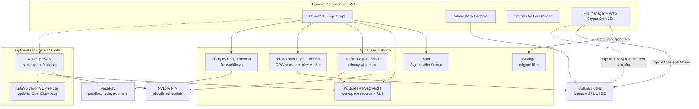
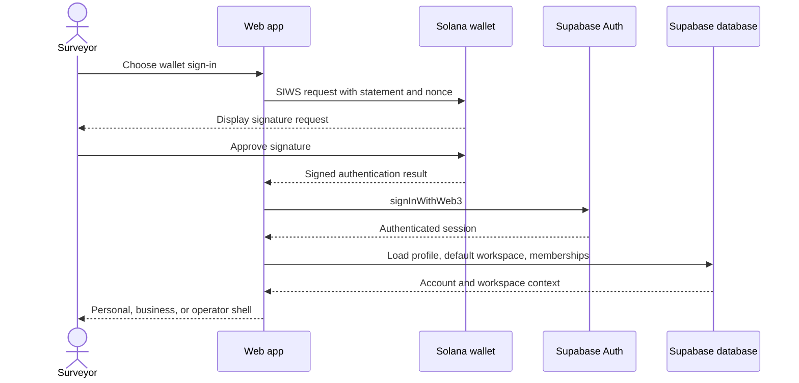
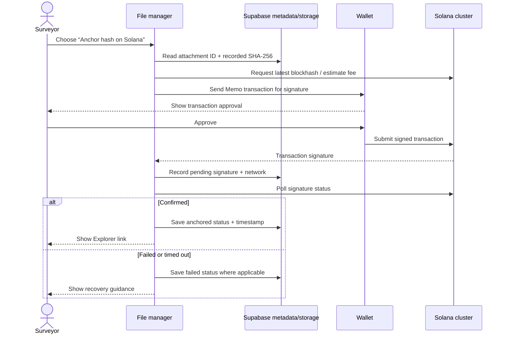

# System architecture & design

SiteSurveyor is an **Eineva Labs product and open-source initiative** for safer digital surveying. The implemented client is a responsive React web application backed by Supabase, with Solana integrations for identity, payments, and file-integrity anchors, plus an AI agent that can inspect and act on allowlisted workspace data. .NET desktop and Java Android SDK clients are native platform targets, not current implementations.

The architecture is deliberately **hybrid by default**. Confidential survey content and operational records remain off-chain; standard Solana anchors carry only explicit transaction data and the minimal file-hash statement. Full-file anchoring is the second, opt-in mode: it commits the file digest and the digest of an encrypted chunk manifest, while the chunks themselves stay in workspace storage. Neither mode treats blockchain as a substitute for confidential storage design.

## 1. Design goals

1. **Keep the job connected.** Quotes, projects, jobs, evidence, costs, invoices, and payments should form one operational record.
2. **Make AI operational, not ornamental.** The assistant uses real tools and returned records rather than generating unsupported status claims.
3. **Minimise on-chain exposure by default.** Keep original survey files and sensitive project metadata out of the standard file-anchor Memo. Require explicit consent and pre-chunk encryption for sensitive content in any full-file storage mode.
4. **Keep settlement rails distinct.** Solana USDC and PesePay fiat flows have separate configuration, behaviour, and confirmation semantics.
5. **Support field and office use.** The web UI is responsive, accessible, installable as a PWA, and explicit about offline/network state; native targets share the same product and security contracts.
6. **State limitations honestly.** Coming-soon tools, synthetic market data, development networks, legacy anchors whose chunk copies predate encryption, and unimplemented native shells remain identifiable.
7. **Keep the framework open.** Eineva Labs develops SiteSurveyor as an inspectable, MIT-licensed framework that surveying teams and contributors can adapt and verify.

## 2. System context



## 3. Repository components

| Component | Responsibility |
| --- | --- |
| `apps/web` | Implemented React SPA/PWA, wallet flows, workspaces, project/CAD UI, file manager, market, and finance screens |
| `apps/engine` | **Python satellite survey engine** — worker polls `survey_runs`, runs multi-sensor raster pipelines (water/minerals/soil/hazard), publishes deliverables to Supabase Storage, exposes MCP server for AI agents |
| `supabase/functions/ai-chat` | Authenticated primary AI endpoint; streams NDJSON events and invokes the shared agent core |
| `supabase/functions/_shared` | Model routing, agent tools, memory, skills, workflows, and shared AI behaviour |
| `supabase/functions/solana-data` | Public Solana RPC proxy and cached market snapshots |
| `supabase/functions/market-verify-payment` | Confirms a marketplace transfer on chain (recipient, amount, finality) and is the only writer of an order's `completed` status |
| `supabase/functions/market-chat` | Public market concierge; anonymous, rate-limited, read-only tools over the published market views |
| `supabase/functions/satellite-survey` | Authenticated survey job intake and credit-priced dispatch to the Python engine |
| `supabase/functions/backfill-geocode` | Admin-only backfill of coordinates for listings and professionals |
| `supabase/functions/delete-user` | Account deletion workflow |
| `supabase/functions/web3-auth` | SIWE/SIWS nonces and wallet link/unlink for signed-in accounts |
| `supabase/functions/pesepay` | Server-side PesePay payment operations |
| `supabase/migrations` | `20260823000000_base_schema.sql` is a schema dump of the deployed project (80 tables, 176 policies); every later file is an incremental change on top of it. Together they rebuild the database from empty — see `README.md` "The database can be rebuilt from empty" |
| `ai-gateway` | Optional Node static host and self-hosted `/api/chat` fallback using the same agent contract |
| `ai-gateway/sitesurveyor-mcp` | MCP server exposing equivalent data, CAD, memory, and workflow tools over stdio |
| `scripts/ai-eval` | Evaluation and consistency checks for models, memory, skills, and tool rounds |
| `apps/desktop`, `apps/mobile`, `apps/live` | Reserved directories for the .NET desktop and Java Android SDK targets plus a live shell; none is implemented, so the web client is the only shipped **user-facing** surface. The Python engine at `apps/engine` is a **backend worker**, not a user-facing client. |

## 4. Frontend architecture

### Workspace shells

`WorkspaceRouter` selects one of three shells from the authenticated profile:

- **Personal:** independent professional workflows.
- **Business:** firm operations, dispatch, staff, and shared resources.
- **Platform operator:** administrative views in addition to the applicable workspace behaviour.

Navigation is view-driven inside the workspace shell. Access filtering determines which views an account can open, while the public `/market` route remains available outside the authenticated workspace.

### Main frontend boundaries

| Boundary | Examples |
| --- | --- |
| `features/personal`, `features/business`, `features/platform` | Account-specific navigation, view registries, and shells |
| `features/projects` | Project dashboard, settings, file integration, and project-tool registry |
| `features/phantom`, `features/web3` | Wallet providers, Solana balances, payments, file anchors, and market feeds |
| `features/ai` | AI workspace interactions |
| `pages/shared` | Cross-account pages such as files, billing, settings, and AI message rendering |
| `lib/repositories` | Supabase data access and domain-specific persistence |
| `lib/auth` | Wallet authentication, session restoration, profile/workspace mapping, and cached user handling |
| `components/ui`, `components/layout` | Shared shadcn/Radix primitives and application layout |

### UI language

The product follows the shadcn-admin structure and neutral slate component language, retaining SiteSurveyor red (`#d92d20`) as the accent for brand marks, primary actions, live indicators, and market highlights. The public market may keep its map/chart/ticker character but uses shared tokens and primitives.

The baseline is keyboard-operable controls, visible focus, labelled fields, field-associated errors, and layouts that remain usable at 390 px width. Mobile web is a first-class field target, not a separate native application.

### Auth and account surfaces

The seven auth surfaces — `/login`, `/signup`, `/forgot-password`, `/reset-password`, `/verify-email`, `/auth/callback` and `/account/security` — are composed as one anchor sheet: a drafting plate beside a working column. `AuthShell` supplies the frame and the `aside.auth-plat` plate it fills with `BlocksAnimation`, and `apps/web/src/styles/auth-plat.css` the vocabulary; each page keeps its own form state, validation, copy, and loading behaviour. The split of ownership is what keeps the screens visually identical, so a new auth or account surface reuses the shell rather than composing its own frame.

At 1024 px and above the sheet splits 44/56 (`minmax(0, 44fr) / minmax(0, 56fr)`) with `grid-template-rows: minmax(0, 1fr)`, so both columns are held to the sheet's own height and a tall working column cannot push the title block past `overflow: hidden`. The sheet is `clamp(560px, 100svh - 88px, 880px)` tall and capped at 1180 px. Below 1024 px the sheet is a full-bleed column (`min-height: 100svh`) and the plate becomes its masthead band.

One measure governs the working column: `--auth-measure`, 27 rem, raised to 34 rem on the one `wide` screen (`/account/security`). It is turned into symmetric padding on `.auth-side-body` and never into a child max-width, so the heading rule, the form, the `OR CONTINUE WITH` rule, and the footer band share one axis. The column scrolls at every width with `scrollbar-gutter: stable`, so the measure stays one number whether or not a bar appears, and `overscroll-behavior: contain`; `.auth-side-bar` and `.auth-side-foot` are `flex: 0 0 auto`, so the footer band never shrinks and clips its content.

Vertical distribution is set by screen type, not by centring the whole column:

- A state screen's `.auth-note` takes the height the column has left and settles its message in the middle of it.
- A `wide` screen widens the measure as described above and otherwise keeps the same vertical rhythm; `.auth-group-start` and `.auth-group-end` are defined for auto-margining a working block, and no screen uses them today.

The working column is the card: `--card` is painted on the sheet, so nothing inside it is nested. What were cards are ruled rows instead — `.auth-choice-set` and `.auth-choice` for account scope and the wallet picker, `.auth-slab` for a tabbed block, `.auth-identity` for the account strip, `.auth-note` for a state screen's message — with `AuthMark` (a ruled square with an inset second rule, in `primary`/`danger`/`success` tones) and `AuthRule` (a ruled annotation kept as readable text rather than `role="separator"`). Selection is ink: `data-selected` gives a muted wash plus a 2 px inset ink bar. Brand red stays on the primary action and the one sealed block on the plate. `.auth-field-row` is defined for a ruled label/value row but is not used by any screen yet.

Plate lettering — the schedule, the cartouche, the specimen stamp, the ruled dividers — uses `--mono-plate`, IBM Plex Mono over the system mono stack, loaded from the same Google Fonts request as Inter and Manrope. The app-wide `--mono` is unchanged, so wallet addresses and ledger code keep the existing stack.

The plate is a plat of record for one full-file anchor run, drawn in the sheet's own grammar: source object, the split into `chunk-0000NN`, a ruled schedule of each chunk's SHA-256 and byte size, `manifest.json`, and one benchmarked block tied back to the file it verifies. Its arithmetic and format come from the product — chunk size and count from `DEFAULT_FULL_FILE_CHUNK_SIZE` over the file size, the memo string from `buildFullFileAnchorMemo`, the cluster cell from `SOLANA_CLUSTER_LABEL[SOLANA_CLUSTER]` so the plate cannot contradict the wallet badge — while the digests, slot, signature and file name are a specimen, which the stamp states as `Specimen run — records invented, mechanics real`. The plate stays decorative (`aria-hidden`) and is never a readout of a real file.

Hovering the schedule bands the row under the pointer and writes that chunk's digest head into the cartouche's `SHA-256` cell. It is gated on `(hover: hover) and (pointer: fine)`, and `@media (hover: none)` hides the band and that cell together, so there is never an aimed row with no field to report to. In the band layout the plate drops all SVG lettering, draws its rules with `vector-effect: non-scaling-stroke` at higher ink because 0.3 user units land under half a pixel there, and stacks the two cartouche cells it keeps (`Chunks`, `Cluster`) in one column so neither ellipsizes. The anchoring sequence — sheet, object, split, rows in file order, manifest, tie line, then the seal — is inert under `prefers-reduced-motion`, which shows the sealed mark directly and drops the ring. These screens are verified at 1440x900 and 390x844.

## 5. Authentication and account mapping



Desktop behaviour prefers native wallet SIWS where available. Mobile/Mobile Wallet Adapter behaviour can use `signMessage`, with Solflare hand-off support. A cryptographically random nonce is generated for SIWS.

After authentication, the app loads the profile and workspace with retries to tolerate trigger lag. Cached session/user data supports offline presentation, but it must not be interpreted as proof that new remote operations succeeded.

## 6. AI agent architecture

### Runtime paths

**Primary:** the browser calls the `ai-chat` Supabase Edge Function with the user's bearer token. The function authenticates the user, verifies conversation ownership, resolves workspace context, persists turns, invokes the shared agent, and streams NDJSON events.

**Fallback:** the Node gateway exposes the same `/api/chat` request/event contract and serves the built SPA. It also authenticates the Supabase user and checks conversation ownership. It is an alternate host, not local/offline inference; NVIDIA and Supabase remain remote dependencies.

**Optional OpenClaw path:** the gateway can delegate to an OpenClaw agent configured with the SiteSurveyor MCP server. This path is buffered, whereas the shared inline agent streams deltas.

### Agent event contract

```text
{"type":"status", "phase":"..."}
{"type":"tool", "name":"..."}
{"type":"delta", "text":"..."}
{"type":"final", "text":"..."}
{"type":"error", "message":"..."}
```

### Model and tool controls

- Models are restricted by a shared allowlist in `supabase/functions/_shared/models.ts`.
- Task-complexity scoring selects the tool-round budget (`MAX_TOOL_ROUNDS` for complex turns, `SIMPLE_MAX_ROUNDS` otherwise). The allowlist currently holds one model, so every request resolves to `DEFAULT_MODEL`; the routing indirection stays so a second model can be added without touching callers.
- The agent has explicit read and write table allowlists.
- Live Supabase OpenAPI schema information helps the model use actual columns.
- Write payloads are checked against the schema; unknown columns are rejected or removed according to the tool path.
- The caller's workspace is stamped onto new business records when applicable.
- Insert and update results are read back and marked as verified before the assistant reports success.
- Update and delete tools require a valid record UUID.
- Permanent deletes require `confirmed=true` after an explicit user confirmation.
- Repeated identical calls and total tool rounds are capped; upstream calls have timeouts.
- Conversation history is bounded, older turns can be summarised, and structured memory can retain selected durable facts.

The assistant's current product behaviour allows ordinary creates and updates to proceed immediately, while destructive deletes require confirmation. CAD geometry is emitted as command blocks and executed by the user in the project workspace; erase operations have an additional confirmation requirement.

### Tool groups

| Group | Tools/behaviour |
| --- | --- |
| Schema & query | Inspect columns, query allowlisted tables, count matching records |
| Operational writes | Insert, update, or explicitly confirmed delete on allowlisted tables |
| Finance workflows | Create quotes from line items; close eligible overdue invoices |
| Scheduling | Schedule jobs and produce assignment warnings/results |
| CAD | Read drawings, list layers, count entities, inspect entities, and generate user-executed command blocks |
| Memory | Remember or forget structured conversation facts |

The MCP server mirrors this tool surface for compatible hosts. Any change to tool contracts should keep the shared Edge/Node agent and MCP definitions aligned and run the AI consistency checks.

## 7. File integrity and Solana anchoring

### Storage model

Original file bytes are uploaded to Supabase Storage, and attachment metadata is stored in Postgres. The browser uses Web Crypto to calculate a lowercase hexadecimal SHA-256 digest. Integrity verification downloads the current object, recomputes the digest, and compares it with the recorded value.

### Anchor transaction

Only one of the following statements is placed in the Solana Memo, chosen by the
mode the surveyor picks in the file manager:

```text
ssv1:<attachment-id>:sha256:<lowercase-file-hash>
ssv2:<attachment-id>:sha256:<file-hash>:<manifest-hash>:<chunk-count>
```

In the full-file mode the per-chunk digests never go on chain. They are packed
into `manifest.json`, whose own digest is the `<manifest-hash>` above, and the
manifest plus the `chunk-0000NN` objects are stored under
`<workspace-id>/anchors/<operation-id>/`. Chunks are encrypted with AES-256-GCM
keyed by PBKDF2-SHA256 (`ssv2e1`) from a passphrase supplied at anchoring time;
recovery decrypts, re-splits, and compares every digest before reassembling the
file. The confirmed transaction records `tx_signature`, `tx_slot` and
`fee_lamports` against the operation.

The transaction uses Solana Memo Program v3 and is signed and fee-paid by the connected wallet. It is a classic, non-versioned transaction for compatibility with the built-in wallet adapter.



The Memo is self-describing so a chain reader can associate the proof with an attachment without publishing the file. In this implemented hash-only mode, the original file remains off-chain. A hash proves byte equivalence only; it does not establish provenance, ownership, correctness, or regulatory acceptance.

### Full-file chunked storage model (opt-in, implemented)

The product framework also defines an optional full-file anchoring model, implemented in the web client as the `ssv2` flow. It deliberately uses one Memo transaction rather than one per chunk, because bytes belong off-chain and only proofs belong on it.

The implemented behaviour is:

1. The user explicitly selects full-file anchoring and sees the cluster, chunk plan, wallet that pays the fee, and the storage cost of the extra copies.
2. A per-operation AES-256 key encrypts the content before any chunk is uploaded; the key is stored only wrapped under a passphrase the user chooses. Key custody stays with the user and there is no recovery service — losing the passphrase costs the chunk copies, not the original file.
3. The plaintext is divided into ordered, fixed-size chunks with a per-chunk digest, so a large file never becomes a large transaction.
4. A manifest records the whole-file digest, chunk order, chunk sizes and digests, and the storage paths needed for retrieval. The manifest digest plus the file digest are what the Memo commits to.
5. During verification the client resolves the manifest, downloads and decrypts the chunks, reassembles them in order, and re-hashes against the anchored digests before offering the rebuilt file for download.

Hash-only anchoring and full-file anchoring remain separate user choices, records, UI labels, and threat models. Neither places file bytes on-chain.

## 8. Payments

### Solana USDC

The frontend reads cluster, RPC, USDC mint, and treasury configuration from `VITE_SOLANA_*` values. The recipient treasury must be configured before the on-chain payment action is shown. Wallet-signed SPL token transactions settle on the selected Solana cluster, and signatures/network details provide reconciliation references.

Development defaults to devnet. Mainnet configuration must be an explicit deployment decision, with matching RPC, mint, treasury, wallet, and operational controls.

### PesePay fiat

Fiat operations run through the PesePay Edge Function and off-chain payment records. The current development constraint is sandbox-only: secrets stay server-side, no live charge is initiated from development, and keys require rotation before production.

The UI and documentation must never blur a pending Solana transaction, a sandbox fiat transaction, and a settled production payment.

## 9. Data classification by location

| Data | Supabase Auth/Postgres | Supabase Storage | AI provider | Solana | PesePay |
| --- | --- | --- | --- | --- | --- |
| Account/workspace profile | Yes | No | Only relevant supplied context | Wallet address may be public through transactions | Only required payment context |
| Operational records | Yes | No | Relevant query/tool context | No | Payment-related subset where applicable |
| Original survey files | Metadata only | Yes by default | Only if explicitly supplied through an AI workflow | **No by default; encrypted chunks only in the planned opt-in full-file mode** | No |
| File SHA-256 + attachment ID | Yes | No | Only if supplied | **Yes, on anchor** | No |
| AI conversations/memory | Yes | No | Prompt/history/tool context | No | No |
| Solana transaction | Signature/status metadata | No | Only if supplied | Yes | No |
| Fiat transaction | Payment metadata | No | Only if supplied | No | Yes |

This table describes intended system flow, not a certification of every possible custom integration. New tools and workflows must update the data-flow review.

## 10. PWA and network behaviour

The Vite PWA configuration caches application assets and selected public image/storage assets. Authenticated Supabase REST responses use `NetworkOnly` so sensitive or current workspace data is not served from a stale service-worker cache.

The application also provides offline status, cached-session restoration, and cached user mapping. These measures improve resilience; they do not make AI, live queries, uploads, or blockchain transactions offline-capable.

## 11. Deployment shapes

### Static host

`render.yaml` builds `apps/web`, publishes `apps/web/dist`, and rewrites application routes to `index.html`. Supabase Edge Functions and external providers remain separate services.

### Docker/Nginx

The multi-stage Dockerfile builds the web app in Node 22 Alpine and serves the static output with Nginx. `docker-compose.yml` exposes it on port 8080. Frontend build arguments become public browser configuration and must never include server secrets.

### Self-hosted AI gateway

The optional Node gateway serves the same static bundle and `/api/chat`. It requires server-side NVIDIA and Supabase service-role configuration and a built MCP artifact at startup. See [AI gateway guide](ai-gateway/README.md).

## 12. Verification strategy

- TypeScript project checks for compile-time contracts.
- ESLint for frontend code quality and hooks rules.
- Vitest + Testing Library for repositories, wallet helpers, file anchors, pages, and UI behaviour.
- Solana browser-ESM and RPC shims in tests to avoid live websocket/network requirements.
- Production build to catch bundling and PWA issues.
- AI evaluation scripts for model, skill, memory, and tool-round behaviour.
- Separate deployment checks for RLS, Storage policies, Edge Function authorization, cluster consistency, and payment reconciliation.

See [Security model](SECURITY.md) for the production security gate and [Web app guide](apps/web/README.md) for commands.
