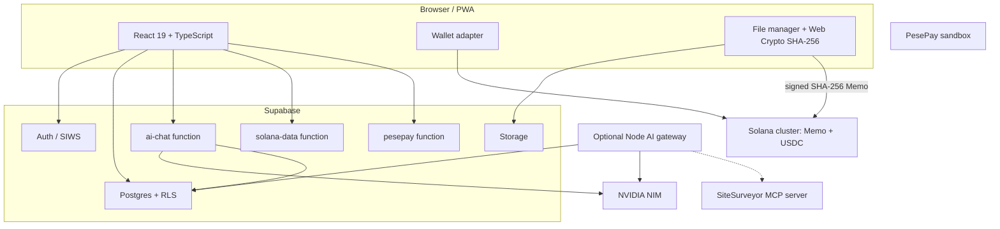

# System architecture & design

The implemented client is a responsive React web app backed by Supabase, with Solana for identity,
payments and file-integrity anchors, plus an AI agent that can inspect and act on allowlisted
workspace data. The desktop shell is a Tauri (Rust) window over the same web frontend; the mobile
shell is still a placeholder.

The architecture is **hybrid by default**: confidential survey content and operational records stay
off-chain, and Solana carries only explicit transactions and the minimal file-digest statement.
Neither anchoring mode treats blockchain as a substitute for confidential storage design.

## 1. Design goals

1. **Keep the job connected.** Quote, project, job, evidence, cost, invoice and payment form one
   operational record.
2. **Make AI operational.** The assistant calls real tools and reads back the records it wrote
   rather than asserting status it cannot support.
3. **Minimise on-chain exposure.** Original files and project metadata never enter the standard
   anchor Memo; full-file storage additionally requires consent and pre-chunk encryption.
4. **Keep settlement rails distinct.** Solana USDC and PesePay fiat have separate configuration,
   behaviour and confirmation semantics.
5. **Support field and office use.** Responsive, accessible, installable PWA that is explicit about
   offline and network state.
6. **State limitations honestly.** Coming-soon tools, synthetic market data, devnet defaults and the
   unimplemented mobile shell stay identifiable.

## 2. System context



## 3. Components

| Component | Responsibility |
| --- | --- |
| `apps/web` | React SPA/PWA: workspaces, projects, jobs, files, finance, market, transport preview |
| `apps/desktop` | Tauri (Rust) shell over `apps/web`: native window, installers, external-link handling |
| `apps/engine` | Python satellite engine — worker polls `survey_runs`, runs raster pipelines (water, minerals, soil, hazard), publishes deliverables, exposes MCP |
| `supabase/functions/ai-chat` | Authenticated AI endpoint; streams NDJSON events into the shared agent core |
| `supabase/functions/_shared` | Model routing, tools, memory, skills, workflows |
| `solana-data`, `pesepay`, `web3-auth` | RPC proxy and market cache; fiat operations; SIWS nonces and wallet linking |
| `market-verify-payment` | Confirms a marketplace transfer on chain; the only writer of an order's `completed` status |
| `market-chat` | Public market concierge — anonymous, rate-limited, read-only tools |
| `satellite-survey` | Authenticated survey job intake and credit-priced dispatch to the engine |
| `supabase/migrations` | `20260823000000_base_schema.sql` is a dump of the deployed schema; later files are incremental. Together they rebuild the database from empty |
| `ai-gateway` | Optional Node static host and self-hosted `/api/chat` using the same agent contract; hosts the MCP server |

## 4. Frontend

`WorkspaceRouter` picks one of three shells from the authenticated profile: **personal** (independent
professional), **business** (firm operations, dispatch, staff) and **platform operator** (admin
views). Navigation is view-driven inside the shell; access filtering decides which views an account
can open. `/market` and `/transport` stay available outside the workspace.

| Boundary | Contents |
| --- | --- |
| `features/{personal,business,platform}` | Account-specific navigation, view registries, shells |
| `features/projects` | Project dashboard, settings, file integration, tool registry |
| `features/{web3,phantom}` | Wallet providers, balances, payments, anchors, market feeds |
| `pages/shared` | Files, billing, settings, AI rendering, shared pages |
| `lib/repositories` | Supabase data access and domain persistence |
| `lib/auth` | Wallet auth, session restoration, profile/workspace mapping |
| `components/{ui,layout}` | shadcn/Radix primitives and application layout |

Design language: shadcn-admin structure and neutral slate tokens, with SiteSurveyor red `#d92d20`
kept for brand marks, primary actions, live indicators and market highlights. Baseline is
keyboard-operable controls, visible focus, labelled fields, field-associated errors and layouts that
survive 390 px.

The seven auth surfaces (`/login`, `/signup`, `/forgot-password`, `/reset-password`, `/verify-email`,
`/auth/callback`, `/account/security`) share `AuthShell` and `apps/web/src/styles/auth-plat.css`: a
drafting plate beside a working column, split 44/56 above 1024 px, one `--auth-measure` for the
working column, and a full-bleed column on phones. Each page owns only its form state, validation and
copy, which is why the screens stay identical. The plate is decorative (`aria-hidden`) and states
that its digests are a specimen.

## 4.1 Desktop shell

`apps/desktop` is a Tauri v2 shell that packages the built `apps/web` bundle as a native window.
It owns no business logic: the window loads the same SPA, and auth, data, AI chat and payments
run exactly as they do in a browser.

The shell's one real responsibility is keeping the user inside the app. The frontend links out to
documentation, Solana Explorer and the public site; in a browser those open a new tab, but in a
native window an unhandled navigation would replace the app with the target page. The shell
therefore cancels off-origin navigations and opens them in the system browser, and refuses to
create a second native window for `target="_blank"`.

Two further differences from the browser build: the desktop bundle does not register the PWA
service worker (the installer already controls the version on disk, so a worker would only serve a
stale bundle after an update), and the packaged window runs under a content security policy.
The policy allows any HTTPS origin for `connect-src` and `img-src` because the app talks to a
configurable Supabase project, a configurable Solana RPC and third-party map tiles — those origins
are not knowable when the installer is built.

**Auth redirects come back through a bridge.** GitHub sign-in, email confirmation and password reset
are finished by the *system browser*, which knows nothing about the app's window — and GoTrue only
redirects that browser to a URL the Supabase project allowlists, which can never include
`http://tauri.localhost`. The browser is therefore sent to a bridge page on the hosted web build
(already covered by the web origin's allowlist entry); that page forwards the URL to the app's
registered `sitesurveyor://app` protocol, the operating system launches the app, and the shell turns
the URL back into an in-app path. The frontend then sees exactly the URL it would have seen in a
browser, and the Supabase client exchanges the PKCE code as usual — the verifier is waiting in the
window's local storage, because the app origin does not change between runs. No dashboard
configuration is needed, but the bridge pages ship with the web bundle, so they must be deployed
before the desktop flow can return. See [AUTHENTICATION.md](AUTHENTICATION.md).

## 5. Authentication

Wallet sign-in (Sign In With Solana) with a cryptographically random nonce. Desktop prefers native
wallet SIWS; mobile uses `signMessage` with Solflare hand-off. After authentication the app loads
profile and default workspace with retries to tolerate trigger lag. Cached session data supports
offline presentation only — it is not evidence that a remote operation succeeded.

## 6. AI agent

**Primary path:** the browser calls `ai-chat` with the user's bearer token. The function authenticates
the user, checks conversation ownership, resolves workspace context, persists turns, runs the shared
agent and streams events.

**Fallback:** the Node gateway exposes the same `/api/chat` contract and serves the built SPA. It is an
alternate host, not offline inference. **Optional OpenClaw path:** the gateway can delegate to an
OpenClaw agent configured with the MCP server; that path buffers instead of streaming deltas.

```text
{"type":"status","phase":"..."}  {"type":"tool","name":"..."}  {"type":"delta","text":"..."}
{"type":"final","text":"..."}    {"type":"error","message":"..."}
```

Controls: models restricted by a shared allowlist in `_shared/models.ts` (one model today, so every
request resolves to `DEFAULT_MODEL`); task complexity selects the tool-round budget; read and write
table allowlists; live schema info so the model uses real columns; write payloads validated against
the schema; workspace stamped onto new business records; insert/update results read back and marked
verified before success is reported; update/delete require a valid UUID; permanent delete requires
`confirmed=true` after explicit confirmation; repeated identical calls and total rounds capped;
bounded history with summarisation and optional structured memory.

Ordinary creates and updates proceed immediately; destructive deletes require confirmation. CAD
output is emitted as command blocks the user executes in the project workspace, and erase operations
require an extra confirmation.

| Tool group | Behaviour |
| --- | --- |
| Schema & query | Inspect columns, query allowlisted tables, count records |
| Operational writes | Insert, update, explicitly confirmed delete |
| Finance | Create quotes from line items; close eligible overdue invoices |
| Scheduling | Schedule jobs with assignment warnings |
| CAD | Read-only: drawing, layers, entity counts, single entity. No write tool, no client executor |
| Memory | Remember or forget structured conversation facts |

The MCP server mirrors this surface. Tool-contract changes must keep edge, Node and MCP definitions
aligned and pass the AI consistency checks.

## 7. File integrity and anchoring

Files are uploaded to Supabase Storage; metadata lives in Postgres. The browser computes a lowercase
hex SHA-256 with Web Crypto. Verification re-downloads the object, recomputes the digest and compares
it with the recorded value. One Memo statement is written, chosen by the mode picked in the file
manager:

```text
ssv1:<attachment-id>:sha256:<file-hash>
ssv2:<attachment-id>:sha256:<file-hash>:<manifest-hash>:<chunk-count>
```

**Hash-only (default).** The original stays off-chain; only the attachment ID and digest are on
chain, so a reader can associate the proof with an attachment without publishing it.

**Full-file (opt-in, implemented).** The plaintext is encrypted with a per-operation AES-256-GCM key
(derived by PBKDF2-SHA256, `ssv2e1`) under a passphrase the user supplies, split into ordered 256 KiB
chunks with per-chunk digests, and stored with `manifest.json` under
`<workspace-id>/anchors/<operation-id>/`. Per-chunk digests never reach the chain — the manifest
digest does. Recovery downloads, decrypts, re-hashes and reassembles. Key custody stays with the
user: losing the passphrase costs the chunk copies, not the original file.

Transactions use Memo Program v3, are signed and fee-paid by the connected wallet, and are classic
(non-versioned) for wallet-adapter compatibility. Confirmed transactions record `tx_signature`,
`tx_slot` and `fee_lamports`. A hash proves byte equivalence only — not provenance, ownership,
accuracy or legal validity.

## 8. Payments

**Solana USDC:** cluster, RPC, mint and treasury come from `VITE_SOLANA_*`. The on-chain action is
hidden until a treasury is configured. Wallet-signed SPL transfers settle on the selected cluster and
their signature and network are the reconciliation references. Development defaults to devnet;
mainnet is an explicit deployment decision.

**PesePay fiat:** operations run through the Edge Function and off-chain records. Sandbox only —
secrets stay server-side, keys are rotated before production, and no live charge comes from a
development session. A pending Solana transaction, a sandbox fiat transaction and a settled
production payment must never read as the same thing.

## 9. Data classification

| Data | Postgres | Storage | AI provider | Solana | PesePay |
| --- | --- | --- | --- | --- | --- |
| Account/workspace profile | Yes | No | Supplied context only | Wallet address may be public | Payment context only |
| Operational records | Yes | No | Query/tool context | No | Payment subset |
| Original survey files | Metadata | Yes by default | Only if explicitly supplied | **No** — encrypted chunks stay in Storage | No |
| File SHA-256 + attachment ID | Yes | No | If supplied | **Yes, on anchor** | No |
| AI conversations/memory | Yes | No | Prompt, history, tool context | No | No |
| Solana / fiat transactions | Metadata | No | If supplied | Yes | Yes |

Intended flow, not a certification of custom integrations: new tools and workflows update this table.

## 10. PWA, deployment, verification

The PWA caches app assets and selected public images; authenticated REST responses use `NetworkOnly`
so workspace data is never served stale. Offline status and cached-session restoration add
resilience — they do not make AI, queries, uploads or transactions offline-capable.

**Static host:** `render.yaml` builds `apps/web`, publishes `apps/web/dist` and rewrites routes to
`index.html`. **Docker/Nginx:** multi-stage build on Node 22 Alpine, served on port 8080; build
arguments become public browser configuration. **Self-hosted AI:** the Node gateway serves the same
bundle plus `/api/chat` and needs server-side NVIDIA and Supabase service-role configuration.

Verification: TypeScript project checks, ESLint, Vitest + Testing Library (with Solana ESM/RPC shims),
the production build, and AI evaluation scripts. Deployment additionally requires RLS, Storage-policy,
Edge Function authorization, cluster-consistency and payment-reconciliation checks — see
[SECURITY.md](SECURITY.md) and the [web app guide](apps/web/README.md).
