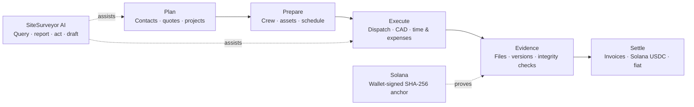
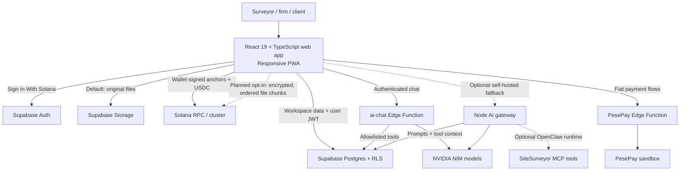

<p align="center">
  
</p>

<h1 align="center">SiteSurveyor</h1>

<p align="center">
  <strong>Your surveying reference point.</strong><br />
  An <strong>Eineva Labs</strong> product and open-source initiative for safer digital surveying.<br />
  An AI-powered, Web3-enabled workspace for planning, executing, evidencing, and settling surveying projects.
</p>

<p align="center">
  <a href="https://react.dev/"></a>
  <a href="https://www.typescriptlang.org/"></a>
  <a href="https://solana.com/"></a>
  <a href="https://supabase.com/"></a>
  <a href="LICENSE"></a>
</p>

---

SiteSurveyor is an **Eineva Labs product and open-source initiative**. It brings the whole job into one connected workspace, giving a surveyor the complete set of tools their work demands, from the first enquiry to a settled payment, rather than a paper field book and a patchwork of disconnected systems.

Its **hybrid Web3 architecture** keeps sensitive survey content in controlled off-chain storage by default while using Solana where it adds clear value: wallet-native sign-in, USDC settlement, and tamper-evident file-hash anchors. SiteSurveyor AI can work directly with that same toolset, so a surveyor moves from a question to a verified action without leaving the workspace.

> **Development status:** the repository defaults to **Solana devnet** and **PesePay sandbox**. Devnet transactions are for development and demonstration, not production evidence or settlement. Complete a deployment security review before using live funds, production chains, or sensitive client data.

## Why Eineva Labs built SiteSurveyor

Surveying is moving from paper field books, manual hand-offs, and disconnected office systems toward digital collection, processing, and project management. That transition can improve efficiency, but cybersecurity is too often left behind. Boundary data, coordinates, plans, client records, and construction information can become exposed to breaches, tampering, and unauthorised access, while centralised workflows can make provenance and change history difficult to inspect.

Eineva Labs created SiteSurveyor as an open-source response: a framework for embracing digital fieldwork without treating security as an afterthought. The goal is one safer digital workspace for work that would otherwise depend on a paper field book and a patchwork of tools, combining practical survey operations, AI assistance, transparent integrity records, and security-conscious data management.

Open source makes the framework inspectable, adaptable, and available for surveying firms, researchers, and contributors to improve together. Blockchain is used selectively for integrity, transparency, and settlement; it is not treated as a replacement for access control, encryption, professional QA, or responsible information governance.

## Documentation

| Document | Audience | What it covers |
| --- | --- | --- |
| [Surveyor user guide](USER_GUIDE.md) | Surveyors, firm leads, operators | Daily workflows, AI, file proofs, payments, and troubleshooting |
| [System architecture & design](DESIGN.md) | Developers, architects | Components, data flows, AI tools, Solana anchoring, and design decisions |
| [Security model](SECURITY.md) | Administrators, developers, auditors | Data boundaries, controls, limitations, and production checklist |
| [Authentication guide](AUTHENTICATION.md) | Developers, administrators | Email, GitHub, and wallet sign-in, account linking, and required configuration |
| [Product brief](PRODUCT.md) | Product and design teams | Users, positioning, capabilities, principles, and constraints |
| [Web app guide](apps/web/README.md) | Frontend developers | Setup, environment, structure, testing, PWA, and build |
| [AI gateway guide](ai-gateway/README.md) | AI/platform developers | Edge Function, self-hosted fallback, MCP, models, and configuration |

## Why SiteSurveyor

**One operational record.** Keep the quote, project, job, crew, files, costs, and invoice connected instead of reconstructing the job across separate tools.

**AI that can use workspace tools.** Ask for operational reporting, create or update allowed records, inspect CAD entities and layers, and prepare CAD commands. Responses stream in real time, and successful record writes are read back for verification.

**Proof without public exposure.** Anchor a file's SHA-256 digest on Solana without putting the original plan, point cloud, photo, or coordinates on-chain.

**Settlement that fits the job.** Keep Solana USDC and local fiat payment flows distinct, with transaction references retained against the workspace's financial records.

**A market connected to the work.** Discover instruments, professionals, firms, jobs, and training through the same platform used to deliver the work.

## The survey lifecycle



## Capabilities

| Area | Included in the workspace |
| --- | --- |
| Plan & price | Contacts, quotes and line items, projects, scheduling, crew planning, and operational dashboards |
| Execute | Jobs, dispatch, assignments, job events, time tracking, expenses, team chat, and notifications |
| CAD & project work | Project drawings, layers and entities, CAD-aware AI inspection, and user-executed AI drafting commands |
| Evidence | File manager, private/public storage options, folders, versions, soft delete and restore, SHA-256 hashing, and integrity verification |
| Web3 | Sign In With Solana, Phantom and Solflare hand-offs, an encrypted built-in wallet option, Solana USDC payments, and file-hash anchoring |
| AI | Streaming chat, conversation history and memory, allowlisted data tools, reporting, record workflows, and CAD tools |
| Finance | Invoices, billing, payment references, Solana USDC, and separate PesePay fiat flows |
| Assets | Instruments, asset details, photos, calibration records, and maintenance history |
| Marketplace | Instruments, professionals, jobs, firms, training, map discovery, filters, and market detail views |
| Administration | Personal and business workspaces plus platform-operator views for users, workspaces, activity, and audit |

Some project-tool cards (currently instrument calibration, field notes, and QA flags) are explicitly marked **coming soon** in the application. They are not presented as working capabilities.

## Security at a glance

SiteSurveyor defaults to blockchain for **integrity and settlement**, not as a public database for confidential survey records. Full-file on-chain storage is a separate, explicit product model with a different privacy and cost profile.

| Information | Primary location | Written to Solana? |
| --- | --- | --- |
| Survey plans, photos, point clouds, and other original files | Supabase Storage by default; encrypted chunks only under the optional full-file model | **No by default; yes only with explicit full-file opt-in, once available** |
| Projects, clients, quotes, jobs, invoices, and workspace records | Supabase Postgres | **No** |
| AI conversations and operational tool results | Supabase Postgres; prompts/context processed by the configured AI provider | **No** |
| File attachment ID and lowercase SHA-256 digest | Attachment metadata and a wallet-signed Solana Memo transaction | **Yes, when hash anchoring** |
| Solana payment transaction | Solana | **Yes** |
| PesePay fiat transaction | PesePay and off-chain payment records | **No** |

### Two file-storage models

**Hash-only anchoring (implemented).** The original file stays in Supabase Storage. Solana receives only its attachment ID and SHA-256 digest, providing a tamper-evident reference without publishing the file.

**Full-file on-chain storage (optional product direction, not yet implemented).** Where a deployment enables this mode, a file is divided into **ordered, verifiable data chunks** and committed across multiple Solana transactions instead of being uploaded as one large transaction. A manifest links the chunks, records their order and transaction references, and connects them to the complete-file integrity record so the payload can be reassembled and verified. Sensitive content must be encrypted **before chunking**, and users must explicitly opt in because on-chain data is public and effectively permanent.

A hash anchor proves that a particular wallet anchored a particular digest at a particular time. It does **not** prove authorship, ownership, survey accuracy, or legal validity, and it does not encrypt the file.

Read the [security model](SECURITY.md) before deploying with real project data.

## Architecture



The production web bundle is static and can be served by Nginx or a static host. Supabase provides the primary backend and AI runtime; the Node gateway is an optional self-hosted serving path, not an offline AI engine.

See [System architecture & design](DESIGN.md) for component responsibilities and sequence diagrams.

## Technology stack

- **Frontend:** React 19, TypeScript, Vite 8, React Router, Tailwind CSS 4, Radix UI/shadcn primitives, Zustand, and React Hook Form.
- **Geospatial & reporting:** Leaflet, GeoJSON types, CAD project models, and Recharts.
- **Web3:** Solana Web3.js, Wallet Adapter, Sign In With Solana, SPL USDC, and Memo-based file anchors.
- **Backend:** Supabase Auth, Postgres, Storage, Realtime, Row Level Security, and Edge Functions.
- **AI:** NVIDIA NIM, an allowlisted model router, streaming tool calling, structured memory, and an optional Model Context Protocol server.
- **Quality & delivery:** Vitest, Testing Library, ESLint, TypeScript project checks, Docker/Nginx, and Render static-site configuration.

## Platform targets

| Client | Technology | Current status |
| --- | --- | --- |
| Web | React 19 + TypeScript, responsive PWA | **Implemented** in `apps/web` |
| Desktop | .NET | Target platform; `apps/desktop` is reserved for the native shell |
| Mobile | Java Android SDK | Target platform; `apps/mobile` is reserved for the Android client |

The current repository contains the web implementation only. Naming the native technology targets does not imply that those clients are already available.

## Repository layout

```text
sitesurveyor-framework/
├── apps/
│   ├── web/                 # Implemented responsive React application
│   ├── desktop/             # .NET desktop target; source placeholder
│   ├── mobile/              # Java Android SDK target; source placeholder
│   └── live/                # Reserved placeholder
├── ai-gateway/              # Optional Node host and AI fallback
│   └── sitesurveyor-mcp/    # MCP exposure of AI data, CAD, memory, and workflow tools
├── supabase/
│   ├── functions/           # AI, Solana-data, payments, and auth Edge Functions
│   └── migrations/          # Database schema changes, policies, and seeds
├── scripts/ai-eval/         # AI evaluation and consistency checks
├── PRODUCT.md               # Product contract
├── DESIGN.md                # Architecture and design
├── AUTHENTICATION.md        # Email, GitHub, and wallet sign-in
├── SECURITY.md              # Security boundaries and deployment checklist
└── USER_GUIDE.md            # End-user workflows
```

## Quick start

### Prerequisites

- Node.js 22 and npm (the Docker build uses Node 22).
- A Supabase project with the repository schema and required Edge Functions.
- A Solana wallet for wallet sign-in and transaction testing. Use devnet for development.
- An NVIDIA NIM API key if you will deploy or run the AI runtime.

### 1. Install dependencies

From the repository root:

```bash
npm install
npm --prefix apps/web install
```

### 2. Configure the web app

```bash
cp apps/web/.env.example apps/web/.env
```

Set at least:

```dotenv
VITE_SUPABASE_URL=https://your-project-ref.supabase.co
VITE_SUPABASE_ANON_KEY=your-anon-or-publishable-key
VITE_SOLANA_CLUSTER=devnet
```

For a linked Supabase project, apply the database migrations with:

```bash
npm run db:push
```

Use your normal reviewed migration process for shared or production environments; do not reset a database containing real work.

### 3. Start the app

```bash
npm run dev
```

Open **http://localhost:5174**. The Vite server also listens on the local network for mobile-web testing.

The frontend can run without the AI service, but AI chat requires the deployed `ai-chat` Edge Function or the optional [self-hosted AI gateway](ai-gateway/README.md).

## Environment variables

| Variable | Required | Purpose |
| --- | --- | --- |
| `VITE_SUPABASE_URL` | Yes | Supabase project URL |
| `VITE_SUPABASE_ANON_KEY` | Yes | Browser-safe anon or publishable key; never a service-role key |
| `VITE_SOLANA_CLUSTER` | No | `devnet` by default; supports `testnet` and `mainnet-beta` |
| `VITE_SOLANA_RPC_URL` | No | Custom RPC endpoint; otherwise the selected cluster's public endpoint is used |
| `VITE_SOLANA_USDC_MINT` | No | Cluster-specific USDC mint override |
| `VITE_SOLANA_TREASURY_ADDRESS` | For Solana payments | Recipient wallet; an empty value hides the on-chain payment action |
| `VITE_ENABLE_PLATFORM_ADMIN_SIGNUP` | No | Exposes the platform-administration signup card only when explicitly enabled |

All `VITE_*` values are embedded in the browser bundle and must be treated as public. NVIDIA keys, Supabase service-role keys, PesePay secrets, wallet seed phrases, and private keys do not belong in this file.

See [web app configuration](apps/web/README.md#configuration) and [AI gateway configuration](ai-gateway/README.md#configuration) for server-side settings.

## Development commands

Run these from the repository root:

| Command | Purpose |
| --- | --- |
| `npm run dev` | Start the Vite development server |
| `npm run typecheck` | Run TypeScript project checks |
| `npm run lint` | Run ESLint |
| `npm test` | Run the Vitest suite once |
| `npm run build` | Create the production web bundle |
| `npm --prefix apps/web run preview` | Preview the production build locally |
| `npm run ai:eval` | Run the AI evaluation harness |
| `npm run ai:skills-check` | Check AI skill consistency |
| `npm run ai:memory-check` | Check AI memory behaviour |
| `npm run ai:models-check` | Check model configuration |
| `npm run ai:rounds-check` | Check tool-round behaviour |

Before submitting a change, run at least `npm run typecheck`, `npm run lint`, `npm test`, and `npm run build` for affected web functionality.

## Docker

Build and serve the production SPA through Nginx:

```bash
docker compose up --build
```

Open **http://localhost:8080**. Supply deployment-specific build values through your local environment rather than treating repository defaults as your own production configuration.

## Current boundaries

- This repository currently implements the **responsive React web application/PWA**. **.NET desktop** and **Java Android SDK mobile** are platform targets; their directories remain placeholders.
- The current web client implements **hash-only anchoring**. Chunked full-file on-chain storage is an optional product direction and is not yet implemented or generally available.
- Solana development defaults to **devnet**. A transaction on one cluster cannot be treated as proof on another; preserve the recorded network and signature.
- The AI gateway still needs network access to NVIDIA and Supabase. “Fallback” means an alternate host, not offline inference.
- AI output requires professional review. A user must execute CAD command blocks, and destructive operations have confirmation safeguards.
- Marketplace sample content and synthetic chart/portfolio data are demonstration material, not verified public market evidence.
- Blockchain anchoring does not replace access control, encryption, backups, retention policy, professional QA, or legal records management. Full-file storage additionally requires pre-chunk encryption for sensitive content and explicit user consent.

## Contributing

Keep product claims tied to implemented behaviour, preserve the distinction between default private off-chain storage, public hash proofs, and any future opt-in full-file mode, and update the relevant guide when a workflow or configuration changes. Follow the [Code of Conduct](CODE_OF_CONDUCT.md) and run the checks above before submitting changes.

## License

SiteSurveyor is an **Eineva Labs product and open-source initiative**, available under the [MIT License](LICENSE).
